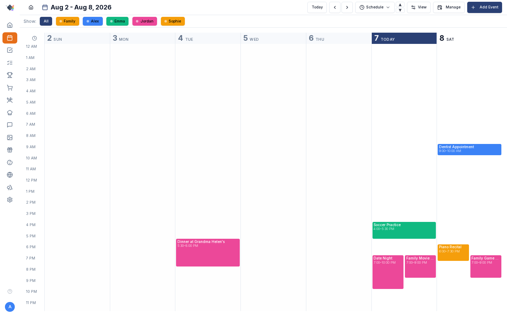
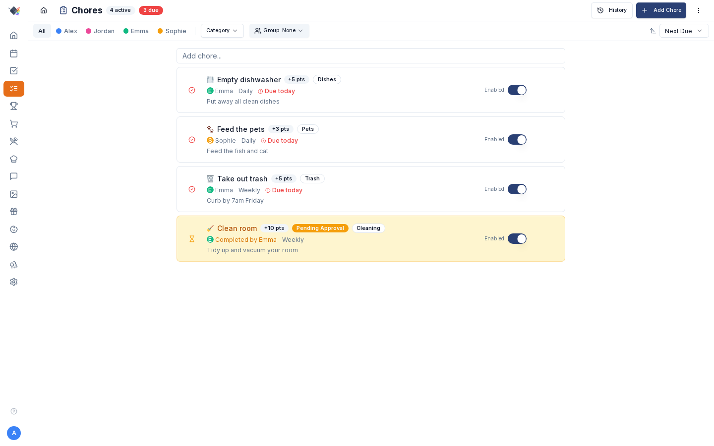
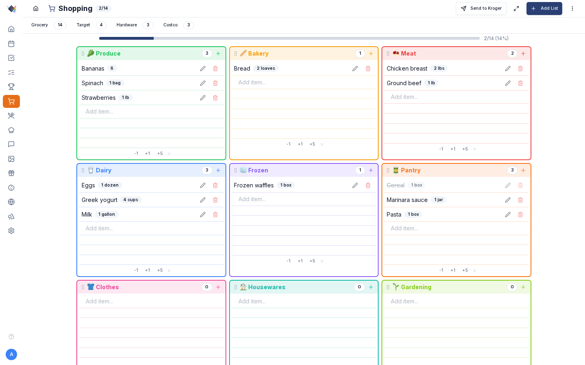
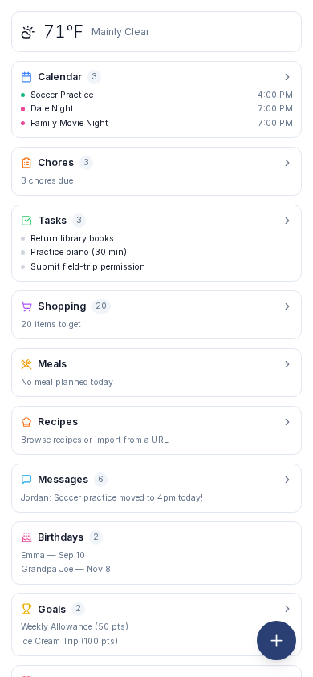
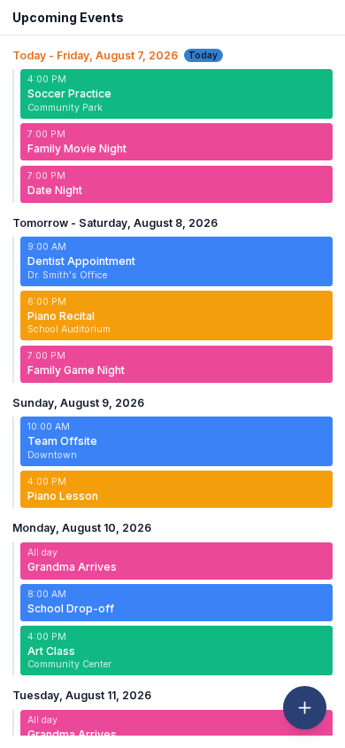
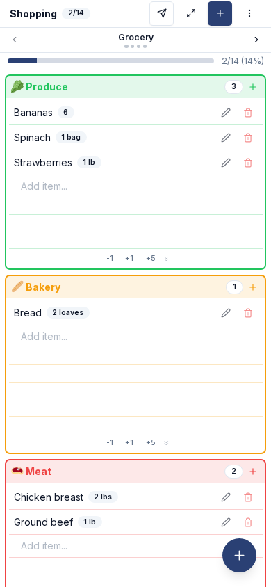

---
hide:
  - toc
---

# Screenshots

What a family sees, captured against a fresh seed (the synthetic Alex / Jordan / Emma / Sophie family) in the looks a new install offers. Your own dashboard will look different. These images are illustrative. The feature pages show the screens for setting things up.

=== "The wall"

    Setup offers three looks. Each is a starting point: the palette, the photo and the card fill can each be changed later.

    

    -   **Photo**: a photo behind glass cards (park scenery until the family adds its own)

    -   **Night**: the same, dark

    -   **Paper**: solid cards, no photo

    -   **When nobody is using it**: the photo, the clock and the weather

    

=== "Close up"

    

    -   **Calendar**

        

    -   **Chores**

        

    -   **Shopping**

        

    

=== "On a phone"

    

    -   **Home**

        { width="300" }

    -   **Calendar**

        { width="300" }

    -   **Shopping**

        { width="300" }

    

